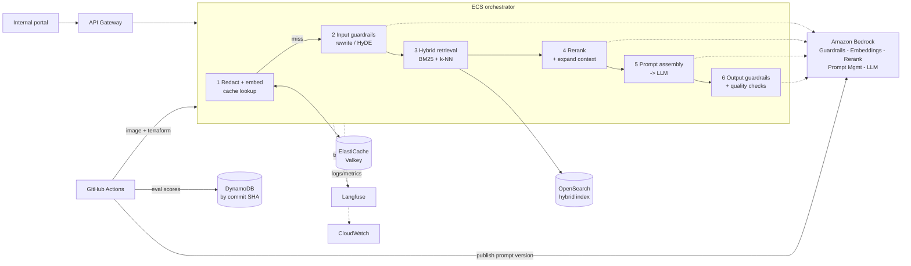

# Insurance Knowledge Retrieval (hybrid RAG on Amazon Bedrock + OpenSearch)

Natural-language Q&A over insurance policy contracts, coverage tables and underwriting
guidelines, for claim adjusters and underwriters. Answers are grounded in retrieved text,
cite the exact document, section and page, always surface the exclusions and limits that
modify the answer, and refuse when the knowledge base does not contain the answer.

Two systems in one repository:

1. **Retrieval service** (`src/insurance_rag/orchestrator`, `api`): a FastAPI orchestrator on
   ECS that runs cache → guardrails → query rewrite/HyDE → hybrid search → rerank → prompt →
   LLM → output checks.
2. **LLMOps pipeline** (`evaluation`, `llmops_prompt_sync.py`, `.github/workflows`): prompts live
   in Git, every commit is scored by an LLM judge, scores are stored by commit SHA, a failed
   threshold blocks deployment, and approved prompts are published to Bedrock Prompt
   Management so production picks them up with no image rebuild.

> **Status, honestly.** The Python code is covered by 55 unit tests (pipeline, chunking,
> redaction, gating, API) that run without AWS, and it passes `ruff` and `mypy --strict`.
> It has **not** been run against real Bedrock, OpenSearch, Redis/Valkey or AWS in the
> environment where it was written, and the Terraform was syntax-checked but not planned or
> applied. Expect to fix small integration details (model ids, region availability, a
> Terraform argument) on your first real run. `docs/CODE_REVIEW_GUIDE.md` lists the exact
> places most likely to need that.

---

## Architecture



Why each choice, in one line each (full reasoning in [`docs/DECISIONS.md`](docs/DECISIONS.md)):
OpenSearch alone does dense **and** sparse search (no second vector database); Bedrock
Knowledge Bases was rejected because chunking/parsing of policy tables must be controlled;
everything model-related runs in Bedrock so PHI/PII never leaves the AWS boundary; Langfuse
gives prompt-level traces CloudWatch cannot; DynamoDB on-demand scales to zero between runs.

| Doc | What it answers |
|---|---|
| [`docs/FLOWS.md`](docs/FLOWS.md) | Step-by-step description of every flow (query, ingestion, LLMOps, observability) with the code for each |
| [`docs/DEPLOYMENT.md`](docs/DEPLOYMENT.md) | Deploy to AWS with Terraform, feed it data, operate it, tear it down |
| [`docs/DATA.md`](docs/DATA.md) | Free public data to use, how to add your own, the synthetic PHI test data |
| [`docs/CODE_REVIEW_GUIDE.md`](docs/CODE_REVIEW_GUIDE.md) | How to review this codebase file by file, with checklists |
| [`docs/DECISIONS.md`](docs/DECISIONS.md) | Architecture decisions and the trade-offs behind them |

---

## Repository layout

```
src/insurance_rag/
  config.py              typed settings (RAG_* env vars)
  models.py ports.py     data models; interfaces the pipeline depends on
  orchestrator/          pipeline.py (the workflow), rewrite.py, context.py, quality.py
  adapters/              bedrock.py, opensearch_store.py, redis_cache.py (implement the ports)
  api/main.py            FastAPI app, health/readiness, correlation ids
  ingestion/             download -> parse -> chunk -> index (+ synthetic data)
  evaluation/            dataset, metrics, ragas_scorer, gate, DynamoDB store, CLI
  prompts_data/          the prompts (Git = source of truth)
  prompts.py             Prompt Management client with TTL cache + baked-in fallback
  redaction.py           regex / Comprehend / Comprehend Medical PHI-PII redaction
  observability.py       optional Langfuse tracing with PHI masking
  bootstrap.py           composition root (the only place adapters are wired)
  cli.py                 init-index, download, generate-claims, ingest, ask
tests/                   55 unit tests, fakes for every port
infra/terraform/         VPC-bound ECS + ALB + API Gateway, OpenSearch, Valkey, DynamoDB,
                         guardrail, KMS, IAM, CloudTrail, alarms
.github/workflows/       ci-cd.yml: lint/types/tests -> quality gate -> deploy
```

---

## Quickstart: run it on your laptop (about 20 minutes, cents of AWS cost)

You need Python 3.12, Docker, and an AWS account with credentials configured
(`aws configure` or SSO). OpenSearch and Redis run locally; only Bedrock calls hit AWS.

**1. Enable Bedrock model access** in the AWS console (Bedrock → Model access) in your
region for *Amazon Titan Text Embeddings V2* and *Amazon Nova Lite*. Rerank
(`amazon.rerank-v1:0`) is offered only in some regions; if yours lacks it, set
`RAG_RERANK_REGION` to one that has it (default `us-west-2`) and enable access there too.

**2. Install and start dependencies**

```bash
cp .env.example .env
make install && source .venv/bin/activate
make up                   # OpenSearch + Redis Stack via docker compose
```

**3. Feed it data** (details in [`docs/DATA.md`](docs/DATA.md))

```bash
make index                # creates the search pipeline + index
make data                 # downloads free FEMA/NFIP policy PDFs + writes synthetic claim notes
make ingest               # parse -> redact -> chunk -> embed -> index
```

Ingestion prints a JSON summary: documents, chunks by type (`clause` / `table` /
`limitation`), and how many identifiers were redacted.

**4. Ask questions**

```bash
make ask Q="How many days do I have to file a proof of loss, and can the deadline be extended?"
```

Or run the API:

```bash
make serve
curl -s localhost:8080/v1/query -H 'content-type: application/json' \
  -d '{"question":"Is a finished basement covered under the dwelling form?"}' | jq
```

A response looks like:

```json
{
  "answer": "Coverage for the basement is limited to ... [S1]. Finished walls and flooring are not covered ... [S2].",
  "citations": [
    {"source_id": "S1", "doc_title": "NFIP Dwelling Form ...", "section_path": "III. Property Covered > A. ...",
     "page": 9, "chunk_type": "clause", "score": 0.91, "excerpt": "..."},
    {"source_id": "S2", "chunk_type": "limitation", "...": "..."}
  ],
  "status": "ok", "cache_hit": false,
  "timings_ms": {"embed_query": 80, "rewrite": 600, "retrieve": 45, "rerank": 190, "generate": 1400, "total": 2500}
}
```

(Illustrative: your numbers and text will differ.) Ask the same thing twice: the second call
returns `"cache_hit": true` in tens of milliseconds and skips every stage after the cache.

**5. Run the quality gate**

```bash
pip install -e ".[eval]"   # pins ragas + a compatible LangChain, see pyproject.toml
make eval
```

Exit code 0 means every threshold in `src/insurance_rag/evaluation/thresholds.yaml` passed.
The seed questions in `dataset.jsonl` are marked `"verified": false`: **check each expected
fact against the PDF edition you downloaded** before trusting the gate (see
[`docs/DATA.md`](docs/DATA.md)).

**6. Run the tests** (no AWS needed)

```bash
make check                # ruff + mypy --strict + 55 tests
```

---

## Deploy to AWS

Summary (full runbook in [`docs/DEPLOYMENT.md`](docs/DEPLOYMENT.md)):

```bash
cd infra/terraform
terraform fmt -recursive                      # once: the CI job fails on unformatted files
cp example.tfvars staging.tfvars              # set vpc_id, private_subnet_ids, github_repo
terraform init && terraform apply -var-file=staging.tfvars -var image_tag=bootstrap
```

then build/push the image, run the ingestion task inside the VPC, and let GitHub Actions
(`ci-cd.yml`) handle every later release: **gate → publish prompt version → push image →
terraform apply → wait for stable**, with ECS circuit-breaker rollback.

**Cost warning for credit-funded accounts.** The deployed stack has always-on parts
(OpenSearch domain, ElastiCache node, ALB, NAT gateway if you need one, Fargate tasks).
Together these cost roughly tens of dollars per month at the smallest sizes; check current
AWS pricing and set an AWS Budget alert first. Develop locally (above), deploy only to test,
and run `terraform destroy` when you stop.

---

## Configuration

All settings are environment variables prefixed `RAG_` (see `.env.example` and
`config.py`). The ones you will actually touch:

| Variable | Default | Purpose |
|---|---|---|
| `RAG_LLM_MODEL_ID` | `us.amazon.nova-lite-v1:0` | Answer model (any Bedrock Converse model) |
| `RAG_EMBED_MODEL_ID` / `RAG_EMBED_DIMENSIONS` | Titan v2 / 1024 | Must match the index; changing it means re-ingesting |
| `RAG_RERANK_REGION` / `RAG_RERANK_MODEL_ID` | `us-west-2` / `amazon.rerank-v1:0` | Rerank is region-limited |
| `RAG_OPENSEARCH_ENDPOINT` / `_AUTH` | `http://localhost:9200` / `none` | `sigv4` on AWS |
| `RAG_KEYWORD_WEIGHT` / `RAG_VECTOR_WEIGHT` | 0.3 / 0.7 | Hybrid blend (must sum to 1) |
| `RAG_RETRIEVE_K` / `RAG_RERANK_TOP_N` / `RAG_MIN_RELEVANCE` | 30 / 6 / 0.05 | Candidates, kept, drop threshold |
| `RAG_CACHE_MODE` | `semantic` | `semantic`, `exact` (hash only, any Redis) or `off` |
| `RAG_CACHE_SIMILARITY` | 0.95 | Cosine threshold for a semantic hit; raise it if you see wrong cache hits |
| `RAG_CORPUS_VERSION` | `v1` | Bump after re-ingesting to invalidate cache |
| `RAG_GUARDRAIL_ID` / `_VERSION` / `_GROUNDING` | unset | Bedrock Guardrails, incl. contextual grounding |
| `RAG_PROMPT_ID` / `_VERSION` | unset | Use Prompt Management instead of the baked-in prompt |
| `RAG_LANGFUSE_ENABLED` | `false` | Needs `LANGFUSE_HOST/PUBLIC_KEY/SECRET_KEY` |

---

## Security and compliance notes

* **PHI/PII path.** User questions are regex-redacted *before* embedding, caching or tracing;
  Bedrock Guardrails anonymises what regexes miss; ingestion redacts before chunking so
  identifiers never reach the embedding model or the index; Langfuse payloads are masked.
  Regex alone does not catch free-text names: use `--redactor regex,comprehend` (and
  `medical` for clinical notes) for real data, and have compliance validate it.
* **Network.** Private subnets, internal ALB reachable only from the API Gateway VPC link,
  IAM-only OpenSearch (SigV4), KMS encryption everywhere, no public endpoints.
* **AuthN/Z.** API Gateway uses `AWS_IAM` by default; swap for a JWT authoriser to use your
  IdP. The service itself performs no end-user authorisation: add document-level access
  filters in `OpenSearchRetriever.search` if different users may see different documents.
* **Audit.** CloudTrail (optional trail in Terraform) for API/configuration access; evaluation
  history by commit in DynamoDB; ECR images immutable and scanned.
* This repository is an engineering reference, not legal or compliance advice.

---

## Known limitations

* Not validated against real AWS services yet (see Status above).
* The semantic cache returns the same answer to everyone; do not put user-specific data
  in answers without adding the user/tenant to the cache namespace.
* Scanned PDFs need OCR (Amazon Textract); the parser only handles text PDFs.
* Evaluation seed questions are unverified against your document edition.
* Query rewriting adds one LLM call (~0.5 s); disable with `RAG_ENABLE_REWRITE=false` if
  latency matters more than recall on vague questions.
* Search pipelines are not available on OpenSearch Serverless, so a managed domain is used.

## Troubleshooting

| Symptom | Likely cause |
|---|---|
| `AccessDeniedException` from Bedrock | Model access not enabled in that region, or IAM lacks `bedrock:InvokeModel` |
| `ValidationException ... on-demand throughput isn't supported` | Use an inference-profile id such as `us.amazon.nova-lite-v1:0` |
| Rerank `ResourceNotFound` / unsupported region | Set `RAG_RERANK_REGION` to a region offering the model |
| `/readyz` returns 503 | OpenSearch unreachable (security group, endpoint, SigV4 vs `none`) |
| Hybrid query error about `normalization-processor` | OpenSearch < 2.10, or the search pipeline was not created: run `make index` |
| Every answer is "could not find this" | Nothing ingested, or `RAG_MIN_RELEVANCE` too high, or embedding model/dimension mismatch with the index |
| Cache never hits | Redis lacks the search module: use Redis Stack locally, or `RAG_CACHE_MODE=exact` |
| `quality_failed` status | The model answered without valid `[S#]` citations; inspect the prompt and model choice |
