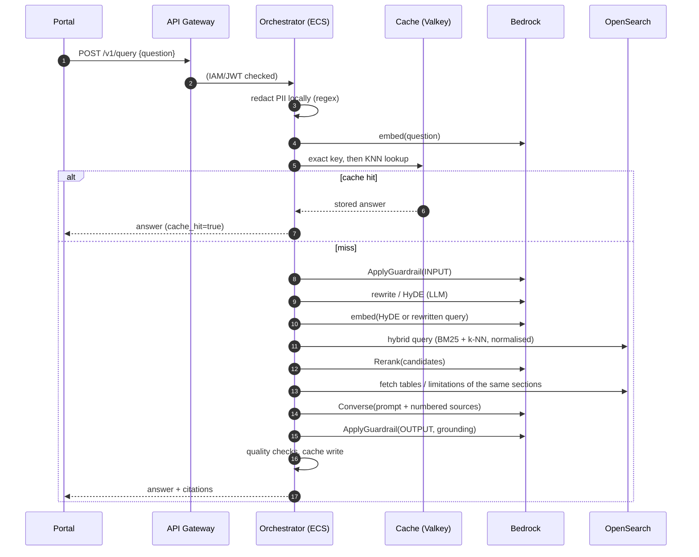

# How the system flows

This document walks through every flow in the architecture, in the order data actually moves,
and points to the code that implements each step. Numbers (1–6) match the diagram.

Contents: [Query flow](#query-flow-the-numbered-steps) · [Ingestion flow](#ingestion-flow) ·
[LLMOps flow](#llmops-flow-prompts-evaluation-deployment) · [Observability and audit](#observability-and-audit-flow) ·
[Failure behaviour](#failure-behaviour)

## Query flow (the numbered steps)



### Step 1: Gateway and cache (`api/main.py`, `orchestrator/pipeline.py`, `adapters/redis_cache.py`)

API Gateway authenticates the caller (IAM by default, JWT optionally), applies throttling,
and forwards over a VPC link to an internal ALB and then an ECS task. FastAPI assigns a
correlation id (`x-request-id`), which appears in every log line and in the response.

The orchestrator first removes identifiers from the question with `RegexRedactor` (free,
offline), so a claimant's SSN typed into a question never reaches the embedding model, the
cache or a trace. It embeds the cleaned question (Titan v2) and asks the cache:

* **Exact tier**: key is the SHA-256 of the normalised question, O(1).
* **Semantic tier**: a KNN search over stored question embeddings; a hit needs cosine
  similarity ≥ `RAG_CACHE_SIMILARITY` (0.95).

A hit returns immediately and skips every later stage; this is how repeated lookups answer in
well under a second. Cache keys include a namespace derived from corpus version, prompt
version, LLM id and index name, so changing any of them invalidates old answers. Only
successful grounded answers are written. A cache failure is treated as a miss.

### Step 2: Guardrails, rewrite and HyDE (`adapters/bedrock.py`, `orchestrator/rewrite.py`)

On a miss, `ApplyGuardrail(INPUT)` runs before any answer tokens are spent: prompt-attack
detection, content filters, and PII anonymisation. If the guardrail *blocks*, the response is
`status: "blocked"`. If it only *anonymises*, the masked text replaces the question for the
rest of the flow.

The rewriter (a small LLM call using `prompts_data/query_rewrite.yaml`) returns JSON:
a retrieval-friendly `query` in policy vocabulary, and optionally a `hyde` passage, a
hypothetical clause that answers the question. For short or conceptual questions the HyDE
passage embeds closer to real clauses than the question does. The BM25 side uses the
rewritten query; the dense side embeds the HyDE passage when present. Any parse or model
failure falls back to the original question, because rewriting must never block an answer.

### Step 3: Hybrid retrieval (`adapters/opensearch_store.py`)

One OpenSearch query contains two sub-queries: a `multi_match` (BM25) over text, section
path and title, and a `knn` over the embedding field. A *search pipeline* normalises both
score sets (min-max) and combines them with weights (0.3 keyword, 0.7 vector, configurable),
so exact terms like "Coverage D" and "$30,000" matter as much as semantic similarity.
The index mapping is `strict` (typos in field names fail loudly) and the vector field is
HNSW with cosine similarity. 30 candidates are returned.

### Step 4: Rerank and structural context (`adapters/bedrock.py`, `adapters/opensearch_store.py`)

Bedrock's Rerank API re-scores the 30 candidates against the question using a cross-encoder,
which is far more precise than embedding similarity. Candidates scoring below
`RAG_MIN_RELEVANCE` are dropped; if none survive the answer is "I could not find this" and the
LLM is never called for generation (this is the main anti-hallucination lever).

Then `expand()` runs: for each surviving chunk's section it fetches the **tables and
limitation clauses** that live in the same section but did not match the query. This is the
fix for the original problem, "critical disclaimers and coverage limitations are frequently
separated from primary text clauses." The chunker made that possible by tagging every chunk
with a `section_id` and a type (`clause`, `table`, `limitation`).

### Step 5: Prompt assembly and generation (`orchestrator/context.py`, `prompts.py`)

`build_context` numbers the sources `[S1]…[Sn]` with document, section path, page and type,
inside a character budget (it drops whole chunks, never truncating mid-chunk). The prompt
comes from `PromptProvider`: the version pinned in Bedrock Prompt Management
(`RAG_PROMPT_ID`/`_VERSION`) if configured, else the YAML baked into the image; a fetch
failure falls back to the baked prompt. The system prompt forces citations, requires
surfacing limitations, forbids outside knowledge and treats source text as data, not
instructions. The call uses Bedrock's Converse API at temperature 0.

### Step 6: Output checks and response (`orchestrator/quality.py`, `adapters/bedrock.py`)

Two independent checks run on the answer:

* **Guardrails (OUTPUT)** with contextual grounding: the answer, question and sources are
  sent so Bedrock scores grounding and relevance against thresholds.
* **Deterministic quality rules**: the answer must cite at least one source (unless it is the
  explicit "could not find" reply), every cited label must exist, and no PII pattern may
  appear.

Outcomes: `ok` (cached, returned with citations), `no_answer`, `blocked`, or
`quality_failed` (a safe message is returned and nothing is cached). The response includes
per-stage timings, so slow stages are visible per request.

## Ingestion flow

```
download -> parse -> redact -> chunk -> embed -> bulk index          (python -m insurance_rag ingest)
```

1. **Download** (`ingestion/download.py`): fetches the PDFs in `sources.yaml`, verifies they
   are really PDFs (not an HTML error page), and records URL, SHA-256, size and timestamp in
   `manifest.json` so every chunk traces to an exact file version.
2. **Parse** (`ingestion/parse.py`): `pymupdf4llm` converts each page to Markdown, keeping
   headings and rendering tables as Markdown tables. `.md`/`.txt` files pass through.
3. **Redact** (`redaction.py`): before chunking, so identifiers never reach the embedding
   model or the index. Layers: regex (always), Comprehend PII (names/addresses), Comprehend
   Medical PHI (clinical notes). Counts per type are reported, never the values.
4. **Chunk** (`ingestion/chunk.py`): structure-aware: heading path per block; tables kept
   whole (huge ones split with the header repeated); exclusion/limitation paragraphs become
   their own `limitation` chunks; ordinary paragraphs are packed to ~1800 characters inside
   a section. IDs are content hashes, so re-ingesting is an idempotent upsert.
5. **Embed and index** (`ingestion/indexer.py`): each chunk is embedded as
   `"<document> | <section path>\n<text>"` (contextual header), 4 concurrent Bedrock calls,
   then bulk-indexed with `_id = chunk_id`. A report (`ingest_report.json`) records counts,
   redaction totals and failures; the command exits non-zero if anything failed.

After re-ingesting, bump `RAG_CORPUS_VERSION` so cached answers from the old corpus are not
served.

## LLMOps flow (prompts, evaluation, deployment)

```
edit prompt in Git -> PR -> lint/types/tests -> quality gate -> merge -> publish + deploy
```

* **Git is the source of truth** for prompts (`prompts_data/*.yaml`). Reviewers see prompt
  changes as normal diffs.
* **Quality gate** (`.github/workflows/ci-cd.yml`, job `eval`): spins up throwaway OpenSearch
  and Redis, ingests the public documents, runs every question in `evaluation/dataset.jsonl`
  through the real pipeline (Bedrock via GitHub OIDC, cache bypassed), and computes:
  * deterministic metrics: citation rate, expected-fact rate, refusal accuracy, p95 latency,
    error rate (`evaluation/metrics.py`);
  * Ragas metrics with Bedrock as LLM-as-a-judge: faithfulness, answer relevancy, context
    precision (`evaluation/ragas_scorer.py`).
* **Gate** (`evaluation/gate.py`): compares scores with `thresholds.yaml`; a missing metric
  counts as a failure. Non-zero exit blocks the workflow.
* **Record**: each run is written to DynamoDB keyed by commit SHA (+ timestamp) with scores,
  failures, model and prompt versions (`evaluation/store.py`). On-demand billing scales to
  zero between runs.
* **Publish and deploy** (job `deploy`, `main` only, protected by an environment approval):
  `llmops_prompt_sync` upserts the prompt in Bedrock Prompt Management and cuts an immutable
  *version*; the image is built and pushed tagged with the commit SHA; Terraform applies
  with that image tag and prompt version; ECS rolls out with circuit-breaker rollback.
  A prompt-only change needs no image rebuild: publish a new version and set
  `prompt_version` (one Terraform apply, tasks roll). If `RAG_PROMPT_VERSION` is left unset
  the service reads the working draft and re-reads it every `RAG_PROMPT_REFRESH_SECONDS`
  (convenient in staging; pin a version in production).

## Observability and audit flow

* **Langfuse** (`observability.py`): each request is a trace; steps (rewrite, rerank,
  generation) are observations with the rewritten query, retrieval counts, model, token
  usage, and prompt name/version. A `mask` function redacts identifiers before data leaves
  the process. Enable with `RAG_LANGFUSE_ENABLED=true` and the `LANGFUSE_*` variables.
* **CloudWatch**: structured JSON logs with the request id, ALB/ECS/OpenSearch metrics, and
  alarms for 5xx, p95 latency, unhealthy hosts and OpenSearch red status (`governance.tf`).
  Infrastructure health stays in the tool DevOps already uses.
* **CloudTrail**: who called which AWS API and who changed configuration (optional trail in
  Terraform). IAM roles are scoped per workload so the trail is meaningful.

## Failure behaviour

| Failure | What happens |
|---|---|
| Redis down or slow (250 ms timeout) | Treated as cache miss; request still answered |
| Prompt Management unreachable | Uses last fetched prompt, else the baked-in prompt; error logged |
| Rewrite LLM fails or returns junk | Original question is used for search |
| Nothing retrieved / nothing relevant | `no_answer`, no generation call |
| Model answers without valid citations | `quality_failed`, safe message, nothing cached |
| Guardrail blocks input or output | `blocked`, nothing cached |
| OpenSearch down | `/readyz` returns 503 (ALB stops routing), `/v1/query` returns 500 with a request id |
| Bedrock throttling | botocore adaptive retries (5 attempts) then a 500 with a request id |
| Bad deployment | ECS circuit breaker rolls back automatically |
